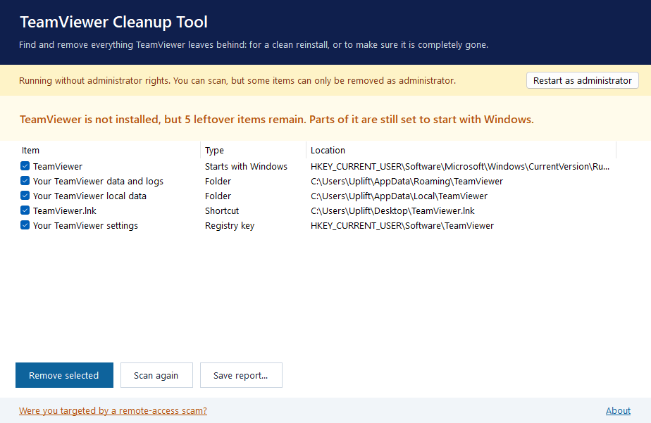
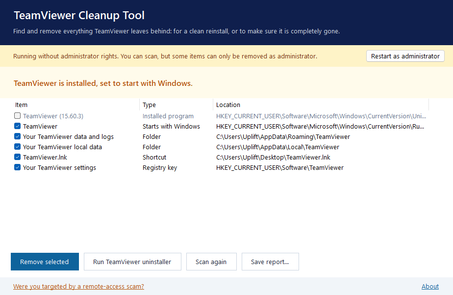
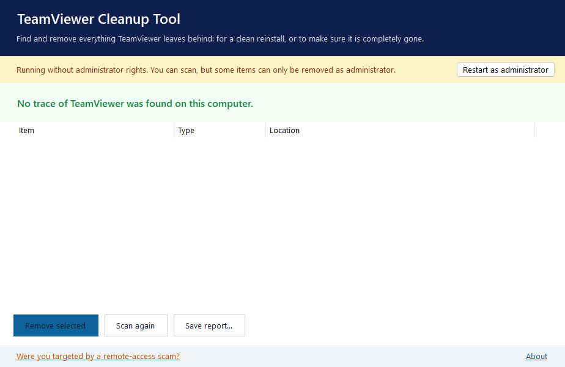

<p align="center"><picture></picture></p>

<h1 align="center">TeamViewer Cleanup Tool</h1>

<p align="center"><b>Find and remove everything TeamViewer leaves behind:</b><br>for a clean reinstall, or to make sure remote access is completely gone.</p>

<p align="center">
  <a href="https://github.com/RatioJuris/TeamViewer-Cleanup-Tool/releases/latest"></a>
  <a href="https://github.com/RatioJuris/TeamViewer-Cleanup-Tool/releases"></a>
  <a href="LICENSE"></a>
  <picture></picture>
</p>

<p align="center"><picture></picture></p>

## Download

Get the [**latest release**](https://github.com/RatioJuris/TeamViewer-Cleanup-Tool/releases/latest). Choose one:

| File | Use it if |
|---|---|
| `TeamViewerCleanupTool-<version>-setup.exe` | You want to install it like any other app |
| `TeamViewerCleanupTool-<version>-x64.msi` | You deploy software with Group Policy, Intune or another management tool |
| `TeamViewerCleanupTool-<version>-portable.exe` | You want to run it once, without installing (about 100 KB) |

Works on Windows 10 and 11 with nothing else to install. Each release includes `SHA256SUMS.txt` and a signed [build provenance attestation](https://docs.github.com/actions/security-for-github-actions/using-artifact-attestations) proving the files were built by GitHub Actions from this source code:

```
gh attestation verify TeamViewerCleanupTool-2.0.0-setup.exe --repo RatioJuris/TeamViewer-Cleanup-Tool
```

The installers are not code-signed, so Windows SmartScreen may warn you. Choose **More info › Run anyway**.

## What it does

1. **Scans** your computer and tells you, in plain language, whether TeamViewer is installed, running, set to start with Windows, or only left leftovers behind. Scanning changes nothing.
2. **Runs TeamViewer's own uninstaller** if it is still installed.
3. **Removes what you select**, in a safe order: closes running TeamViewer programs, stops and deletes the service, removes startup entries, shortcuts, folders and registry settings.

| What it looks for | Where |
|---|---|
| Program files | `Program Files\TeamViewer`, `Program Files (x86)\TeamViewer` |
| Data and logs | `%APPDATA%`, `%LOCALAPPDATA%`, `%ProgramData%` and `%TEMP%` |
| Settings | `HKLM\SOFTWARE\TeamViewer` (64-bit and 32-bit views), `HKCU\Software\TeamViewer` |
| Startup entries | `Run` keys for all users and for you |
| Service and programs | the TeamViewer service; `TeamViewer.exe`, `TeamViewer_Service.exe`, `tv_w32.exe`, `tv_x64.exe` and others |
| Shortcuts | Start menu and desktop, for all users and for you |
| Installation | Windows' list of installed programs |

**Safety first:** before anything is deleted, the tool checks again that its own name is *TeamViewer*. It can never remove a parent folder like `Program Files` or an unrelated registry key, even by mistake. This is covered by automated tests.

<table>
<tr>
<td width="50%"><picture></picture><p align="center"><sub>TeamViewer still installed: run its own uninstaller first</sub></p></td>
<td width="50%"><picture></picture><p align="center"><sub>After cleaning</sub></p></td>
</tr>
</table>

## Were you targeted by a remote-access scam?

Scammers posing as banks, couriers, tech support or government offices often ask people to install TeamViewer or a similar app. If this happened to you:

1. Disconnect the computer from the internet.
2. Use this tool to remove TeamViewer completely, then restart the computer.
3. From a different device, change your email, banking and other important passwords.
4. Call your bank immediately if you shared card, UPI or banking details.
5. **In India**, call the **National Cyber Crime Helpline 1930** or report at **[cybercrime.gov.in](https://cybercrime.gov.in)**. Elsewhere, contact your local police.

## Command line

For scripts and IT administrators:

```
TeamViewerCleanupTool.exe --scan [--log report.txt]
TeamViewerCleanupTool.exe --clean --yes [--uninstall] [--log report.txt]
```

| Option | Meaning |
|---|---|
| `--scan` | List what is found; change nothing |
| `--clean --yes` | Remove everything found (`--yes` is required, so nothing is removed by accident) |
| `--uninstall` | With `--clean`: first run TeamViewer's own uninstaller silently |
| `--log FILE` | Also write the report to a file |

| Exit code | Meaning |
|---|---|
| 0 | Nothing found, or everything removed |
| 1 | Traces found (`--scan`) |
| 2 | Some items could not be removed |
| 3 | Administrator rights are needed |
| 4 | TeamViewer is still installed |
| 64 | Invalid options |

Run `--clean` from an elevated Command Prompt or PowerShell when TeamViewer was installed for all users.

## What this tool is not

- **It does not reset TeamViewer IDs, change licence status or work around TeamViewer's commercial-use detection.** If TeamViewer has flagged your free licence, contact TeamViewer.
- **It is not affiliated with or endorsed by TeamViewer.** TeamViewer is a trademark of TeamViewer Germany GmbH.

## Build from source

Requires the [.NET SDK](https://dotnet.microsoft.com/download) (8 or later) and [Inno Setup 6](https://jrsoftware.org/isinfo.php).

```powershell
./build.ps1          # tests, then builds dist\ with the portable EXE, setup EXE, MSI and checksums
dotnet test          # tests only
```

| Folder | Contents |
|---|---|
| `src/TeamViewerCleanup/Core` | Scanner, cleaner, safety checks, report |
| `src/TeamViewerCleanup` | Windows app (`MainForm.cs`) and command line (`Cli.cs`) |
| `tests/` | Unit tests and an integration test with a fake TeamViewer installation |
| `installer/` | Inno Setup script (EXE) and WiX v5 project (MSI) |
| `tools/` | Icon and screenshot scripts |

The app targets .NET Framework 4.8, which is part of Windows 10 and 11.

## Privacy, terms and support

The tool works entirely on your computer and sends nothing anywhere. See the [Privacy Policy](https://ratiojuris.github.io/legal/teamviewer-cleanup-tool/privacy/), [Terms of Use](https://ratiojuris.github.io/legal/teamviewer-cleanup-tool/terms/) and [Support](https://ratiojuris.github.io/legal/teamviewer-cleanup-tool/support/). Report bugs in [Issues](https://github.com/RatioJuris/TeamViewer-Cleanup-Tool/issues).

## Licence

[MIT](LICENSE) © 2018–2026 RatioJuris. Version 1.0 (2018) was released under the Apache License 2.0.
